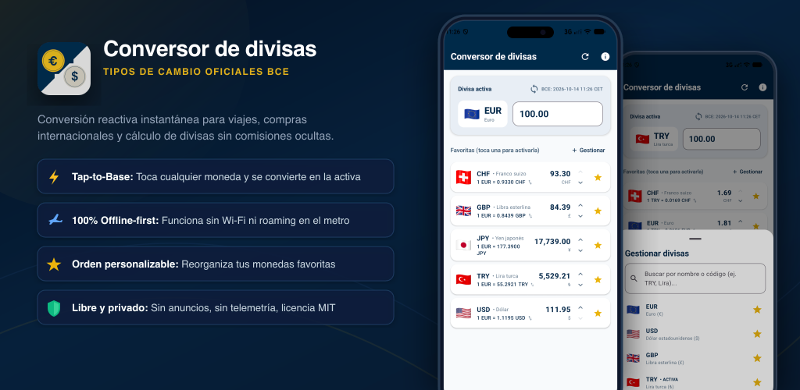
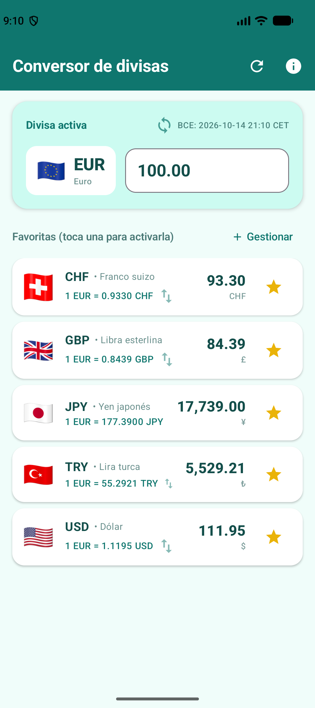
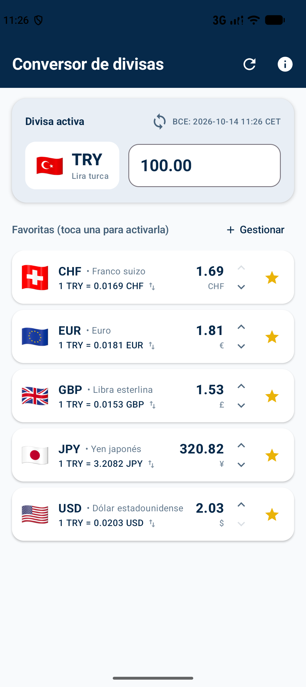
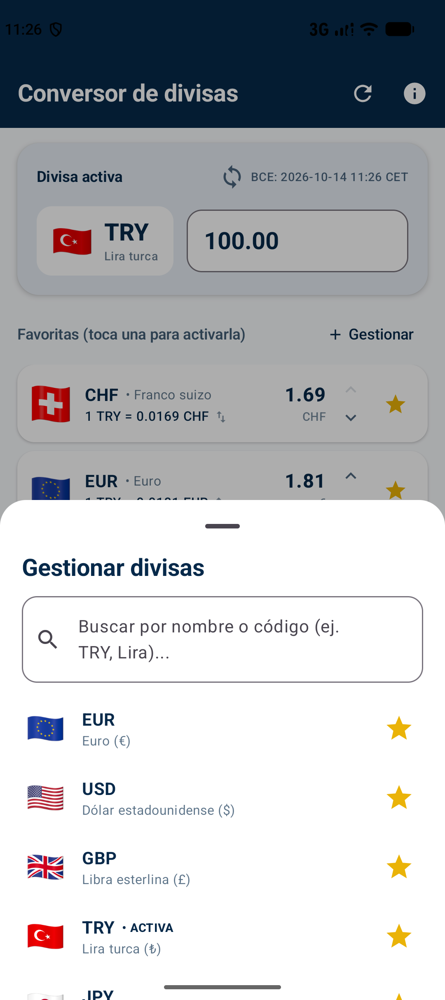
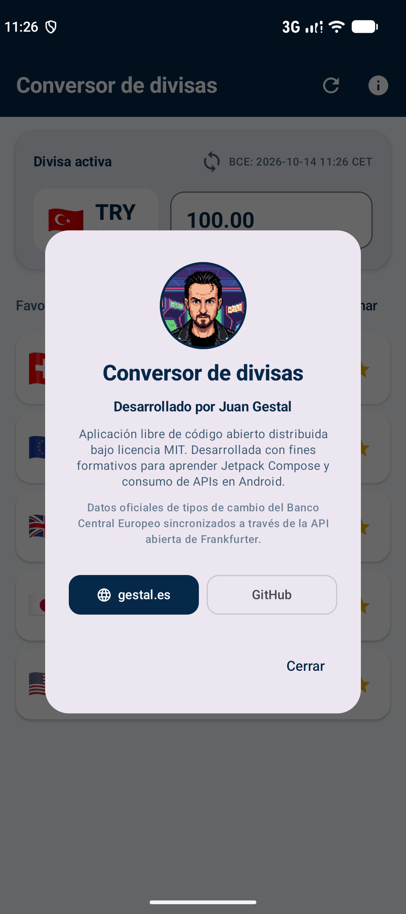

# 💶 Conversor de Divisas para Android

[](https://kotlinlang.org)
[](https://developer.android.com/jetpack/compose)
[](https://developer.android.com/topic/architecture)
[](https://developer.android.com)
[](https://developer.android.com)
[](LICENSE)
[-blue.svg?style=flat)](https://api.frankfurter.dev)

<p align="center">
  
</p>

Aplicación Android moderna, ultraligera y de alto rendimiento desarrollada con **Jetpack Compose** y **Material Design 3**. Diseñada específicamente pensando en las necesidades cotidianas del viajero, permite convertir instantáneamente entre 24 divisas mundiales utilizando los tipos de cambio oficiales de referencia del **Banco Central Europeo (BCE)** a través de la API pública y abierta de **Frankfurter**.

> 💡 **Filosofía del proyecto:** 100% de código abierto bajo licencia MIT, libre de publicidad (*ad-free*), sin compras integradas, con total respeto por la privacidad (cero rastreo de datos) y diseñada con arquitectura profesional y didáctica.

---

## ✨ Características destacadas

* 🔄 **Interacción reina «Tap-to-Base»:** Toca cualquier tarjeta de la lista de favoritas para convertirla al instante en la moneda base activa superior (*Hero*), invirtiendo el cálculo a 60 FPS sin transiciones lentas ni menús engorrosos.
* 📶 **Resiliencia sin conexión (*100% Offline-First*):** La app almacena en caché local (`SharedPreferences`) las últimas tasas sincronizadas y la fecha oficial del BCE. Funciona a la perfección en aviones, metros subterráneos o países sin cobertura de datos móviles.
* ↕️ **Reordenación ergonómica de favoritas:** Cada tarjeta incorpora flechas interactivas para ordenar las monedas prioritarias según las etapas de tu viaje, preservando el orden exacto entre sesiones.
* 📋 **Catálogo deslizable con `ModalBottomSheet`:** Hoja nativa de Material 3 con buscador en tiempo real (por nombre o código ISO 4217) y adición/eliminación de monedas con un solo toque.
* 🚩 **Banderas emoji nativas:** Las insignias nacionales se representan mediante secuencias Unicode nativas (🇪🇺, 🇺🇸, 🇬🇧, 🇹🇷, 🇯🇵, 🇨🇭...), eliminando decenas de pesados archivos SVG/PNG y garantizando nitidez vectorial sin consumo de memoria.
* 🎨 **Identidad visual corporativa y Splash Screen API:** Paleta elegante basada en Azul Marino Profundo (`#06294A`), Oro (`#E0B01B`) y Plata (`#C4C0B4`), con icono adaptativo e integración oficial de la Splash Screen API de Android 12+.
* ⚡ **Microanimaciones y motion design:** Desaparición suave de tarjetas al desmarcarlas (`Modifier.animateItem`), física elástica de resortes (*spring physics*) y transiciones estilo panel de aeropuerto con `AnimatedContent`.
* 🌍 **Internacionalización en 8 idiomas (i18n):** Traducción completa al inglés (por defecto), español, francés, alemán, portugués, italiano, turco y japonés.

---

## 📱 Capturas de pantalla

### Ficha oficial en Español (Play Store)

| 01. Pantalla principal | 02. Interacción Tap-to-Base | 03. Modal de gestión | 04. Diálogo de créditos |
| :---: | :---: | :---: | :---: |
|  |  |  |  |
| *Tarjeta Hero activa (EUR) y lista de favoritas ordenadas.* | *Inversión instantánea de cálculo (TRY ⇄ EUR).* | *Hoja inferior con buscador y selección rápida.* | *Créditos del autor, avatar WebP y licencia.* |

> 🌐 **Pack internacional en inglés:** En la carpeta [`docs/play_store/screenshots/en/`](docs/play_store/screenshots/en/) dispones del set de capturas homólogo en inglés (`Currency Converter`, `Active currency`, `Favorites`, etc.) preparado para la ficha internacional de Play Store.

---

## 🛠️ Tecnologías utilizadas

| Área | Tecnología | Versión | Propósito en el proyecto |
| :--- | :--- | :---: | :--- |
| **Lenguaje** | [Kotlin](https://kotlinlang.org) | 2.0.21 | Código idiomático, seguro contra nulos y concurrente con corrutinas. |
| **UI Declarativa** | [Jetpack Compose](https://developer.android.com/jetpack/compose) | BOM 2024.10.01 | Construcción de interfaces reactivas mediante funciones `@Composable`. |
| **Sistema de Diseño** | [Material Design 3](https://m3.material.io) | Material 3 | Tarjetas, campos de texto, hojas modulares y paleta dinámica de colores. |
| **Arquitectura** | Android Architecture Components | 2.8.7 | `ViewModel`, `StateFlow` y ciclo de vida reactivo (MVVM + UDF). |
| **Red HTTP** | [Retrofit](https://square.github.io/retrofit/) | 2.11.0 | Cliente REST con soporte nativo de corrutinas (`suspend fun`). |
| **Serialización** | [Google Gson](https://github.com/google/gson) | 2.11.0 | Deserialización dinámica del nodo `rates` a `Map<String, Double>`. |
| **Logging de red** | OkHttp Logging Interceptor | 4.12.0 | Trazabilidad y depuración de peticiones HTTP en consola. |
| **Splash Screen** | AndroidX Core SplashScreen | 1.0.1 | Pantalla de arranque compatible desde Android 8.0 hasta Android 15+. |
| **Persistencia** | Android SharedPreferences | Nativo | Almacenamiento ligero de tasas y orden de favoritas (*Offline-first*). |
| **SDK Compatibilidad** | Min SDK 26 / Target SDK 37 | Android 8.0 - 16 | Máxima cobertura de mercado y optimizado para versiones modernas. |

---

## 🏛️ Arquitectura del software (MVVM + UDF)

La aplicación sigue escrupulosamente la guía oficial de arquitectura recomendada por Google, dividiendo el código en tres capas desacopladas con **Flujo Unidireccional de Datos (Unidirectional Data Flow)**:

```text
┌────────────────────────────────────────────────────────────────────────┐
│                        CAPA DE PRESENTACIÓN (UI)                       │
│                                                                        │
│   MainActivity.kt ───► ConversorScreen.kt (Scaffold + Compose)         │
│                              │                                         │
│         ┌────────────────────┴────────────────────┐                    │
│         ▼                                         ▼                    │
│   TarjetaHeroActiva.kt                      BottomSheetGestionDivisas  │
│   TarjetaDivisaFavorita.kt                  PantallaSinDivisas.kt      │
│   DialogoCreditos.kt (WebP)                 ConversorTheme.kt          │
└────────────────────────────────────────────────────────────────────────┘
                  ▲                                    │
                  │ Estado inmutable                   │ Eventos de usuario
                  │ StateFlow<ConversorUiState>        │ (Tap-to-Base, importe, reorden)
                  │                                    ▼
┌────────────────────────────────────────────────────────────────────────┐
│                  CAPA DE NEGOCIO Y ESTADO (VIEWMODEL)                  │
│                                                                        │
│   ConversorViewModel.kt                                                │
│   ├── Cálculo aritmético reactivo en RAM (60 FPS)                      │
│   ├── Gestión de favoritas y ordenamiento                              │
│   └── Corrutinas en Dispatchers.IO para sincronización de red          │
└────────────────────────────────────────────────────────────────────────┘
                  ▲                                    │
                  │ Tasas actualizadas                 │ Lectura y guardado
                  │ y estado de caché                  │ local
                  │                                    ▼
┌────────────────────────────────────────────────────────────────────────┐
│                          CAPA DE DATOS (DATA)                          │
│                                                                        │
│   DivisaModelos.kt       ───► DTOs (CambioRespuesta) y entidades       │
│   DivisasCatalogo.kt     ───► 24 divisas con banderas emoji y buscador │
│   PreferenciasDivisas.kt ───► SharedPreferences + JSON (Offline-first) │
│   DivisaApi.kt           ───► Cliente Retrofit (API Frankfurter / BCE) │
└────────────────────────────────────────────────────────────────────────┘
```

---

## 📚 Tutorial completo paso a paso

El proyecto incluye un tutorial técnico integral dividido en 8 capítulos secuenciales, ideal para el autoaprendizaje o impartición en cursos de desarrollo Android profesional:

| Capítulo | Enlace directo | Temas clave que cubre |
| :---: | :--- | :--- |
| **00** | [Especificaciones, diseño y API](tutorial/00_Especificaciones_Diseno_y_Analisis_API.md) | Análisis del caso de uso del viajero, interacción *Tap-to-Base*, modelado con `Map<String, Double>` y API de Frankfurter. |
| **01** | [Configuración del proyecto y recursos](tutorial/01_Configuracion_del_Proyecto_y_Recursos.md) | Gradle Kotlin DSL, dependencias, permiso de internet, Splash Screen API corporativa, iconos adaptativos e i18n. |
| **02** | [Arquitectura y estructura del proyecto](tutorial/02_Arquitectura_y_Estructura_del_Proyecto.md) | Patrón MVVM, flujo unidireccional (*UDF*), separación de capas y mapa detallado de paquetes y responsabilidades. |
| **03** | [Capa de datos y red](tutorial/03_Capa_de_Datos_y_Red.md) | Modelos DTO, catálogo de divisas con banderas emoji, persistencia ligera en `SharedPreferences` y cliente Retrofit. |
| **04** | [ViewModel y cálculo reactivo](tutorial/04_ViewModel_y_Calculo_Reactivo.md) | `ConversorViewModel`, estado inmutable con `ConversorUiState`, recálculo en memoria a 60 FPS y soporte *offline-first*. |
| **05** | [Interfaz gráfica en Jetpack Compose](tutorial/05_Interfaz_Grafica_Jetpack_Compose.md) | Paleta de colores, avatar WebP en `DialogoCreditos`, tarjetas modulares, `ModalBottomSheet`, buscador y pantalla vacía. |
| **06** | [Animaciones y microinteracciones](tutorial/06_Animaciones_y_Microinteracciones_en_Compose.md) | `Modifier.animateItem()`, física de resortes (*springs*), transiciones estilo panel con `AnimatedContent` y aceleración GPU. |
| **07** | [Preparación y publicación en Play Store](tutorial/07_Preparacion_y_Publicacion_Play_Store.md) | Generación de *Keystore*, App Bundle (`.aab`), guía para superar los 20 evaluadores durante 14 días y URLs de Google Play Console. |

---

## 🛡️ Privacidad, seguridad de datos y permisos

La aplicación se ha concebido bajo el principio de **privacidad desde el diseño (*Privacy by Design*)**:

* 🔒 **Permisos mínimos:** Únicamente requiere `android.permission.INTERNET` para descargar las tasas oficiales del BCE. No accede a ubicación, contactos, cámara ni almacenamiento del teléfono.
* 🚫 **Cero recopilación de datos (*Zero Telemetry*):** No integra Firebase Analytics, Google Analytics, identificadores publicitarios (Advertising ID) ni SDKs de terceros.
* 🛡️ **Comunicaciones cifradas:** Todas las consultas a Frankfurter API se realizan bajo el protocolo seguro HTTPS/TLS.
* 📄 **Documentación legal completa:**
  * [Política de privacidad oficial (Español / Inglés)](docs/play_store/politica_de_privacidad.md)
  * [Checklist y cuestionarios de Google Play (Data Safety, IARC PEGI 3)](docs/play_store/guia_publicacion_checklist.md)
  * [Textos y metadatos de ficha ASO](docs/play_store/ficha_play_store.md)

---

## 🚀 Compilación y ejecución

### Prerrequisitos
* **Android Studio:** Ladybug (2024.2.1) o superior.
* **JDK:** Java 17 o Java 21 (recomendado Eclipse Temurin 21).
* **Dispositivo:** Teléfono físico o emulador con Android 8.0 (API 26) o superior.

### Compilar desde la terminal:

```bash
# 1. Acceder al módulo del proyecto Android
cd app

# 2. Compilar el código Kotlin
./gradlew compileDebugKotlin

# 3. Ejecutar las pruebas unitarias
./gradlew testDebugUnitTest

# 4. Generar el APK de depuración para instalar en tu teléfono
./gradlew assembleDebug

# 5. Compilar el binario oficial optimizado para Google Play Store (.aab)
./gradlew bundleRelease
```

Los binarios generados se encontrarán en:
* APK de pruebas: `app/app/build/outputs/apk/debug/app-debug.apk`
* App Bundle de producción: `app/app/build/outputs/bundle/release/app-release.aab`

---

## 📁 Estructura del repositorio

```text
Conversor-de-divisas-para-Android/
├── app/                                  # Proyecto nativo para Android Studio
│   ├── app/src/main/
│   │   ├── java/es/gestal/conversordivisas/
│   │   │   ├── data/                     # Capa de datos: Retrofit, modelos, catálogo y SharedPreferences
│   │   │   ├── ui/                       # UI: ViewModel, UiState, ConversorScreen y temas
│   │   │   │   ├── components/           # Componentes modulares (Hero, Favoritas, BottomSheet, Créditos)
│   │   │   │   └── theme/                # Paleta corporativa (Color.kt, Theme.kt, Type.kt)
│   │   │   └── MainActivity.kt           # Punto de arranque y Splash Screen API
│   │   └── res/                          # Recursos (values, mipmaps, drawables, strings en 8 idiomas)
│   ├── build.gradle.kts                  # Configuración de Gradle a nivel de módulo
│   └── settings.gradle.kts               # Configuración de repositorios y plugins
├── docs/                                 # Recursos visuales y documentación oficial
│   ├── assets/                           # Iconos vectoriales fuente SVG y fotos del autor
│   ├── screenshots/                      # Capturas a 1080x2424 px en español e inglés
│   └── play_store/                       # Ficha de Play Store, checklist, política de privacidad y gráficos
├── tutorial/                             # Tutorial pedagógico completo de 8 pasos (00 al 07)
├── LICENSE                               # Licencia libre MIT
├── .gitignore                            # Filtro de exclusiones para Git
└── README.md                             # Documentación principal del repositorio
```

---

## 👤 Autor y Licencia

* **Autor:** **Juan Gestal** — Ingeniero de software y formador en desarrollo móvil.
  * Sitio web: [gestal.es](https://gestal.es)
  * Perfil en GitHub: [@jgestal](https://github.com/jgestal)
* **Licencia:** Distribuido bajo la **[Licencia MIT](LICENSE)**. Eres completamente libre de utilizar, estudiar, bifurcar y adaptar este código para tus propios proyectos personales, formativos o comerciales.
* **Fuente de tipos de cambio:** Banco Central Europeo suministrado mediante la infraestructura abierta de [Frankfurter API](https://api.frankfurter.dev).
